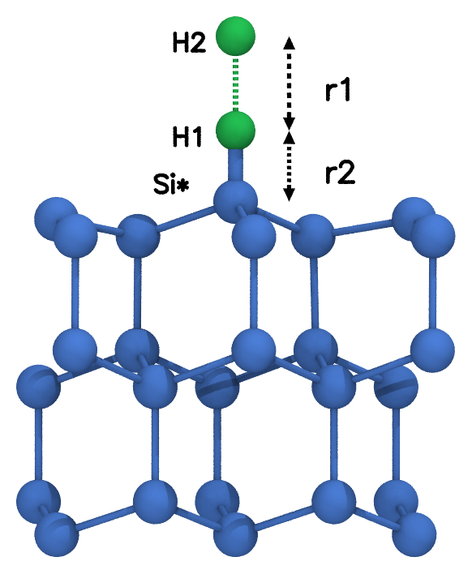
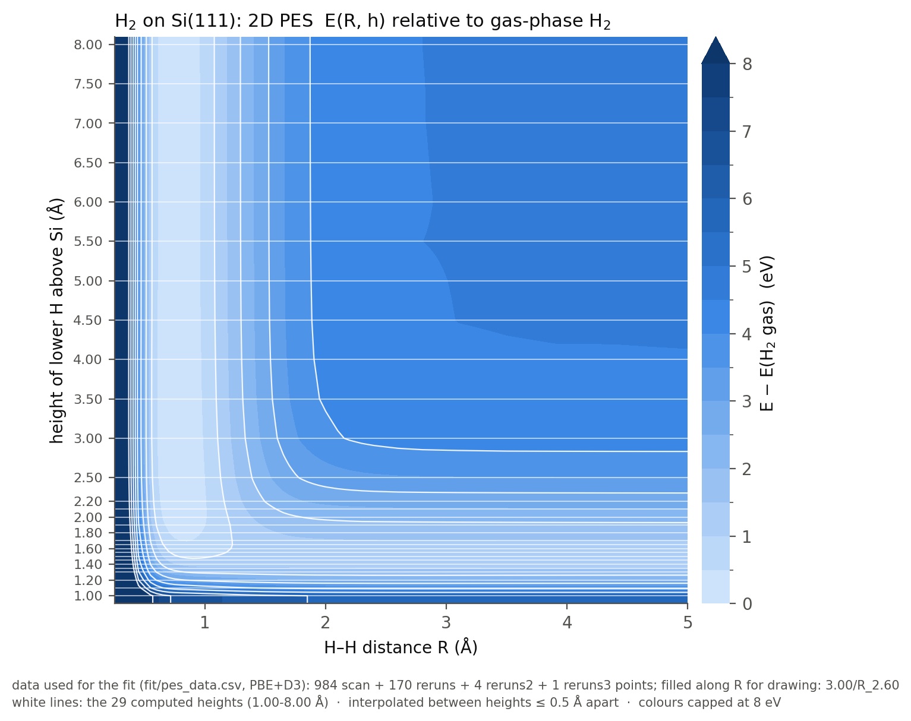
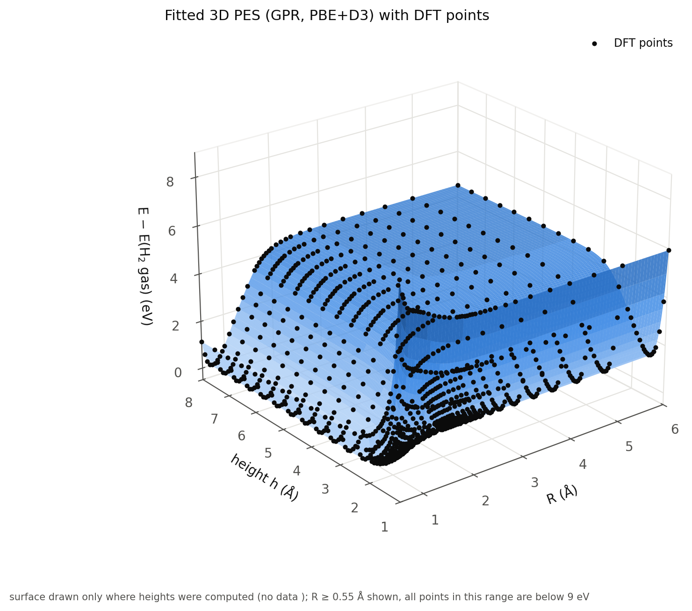
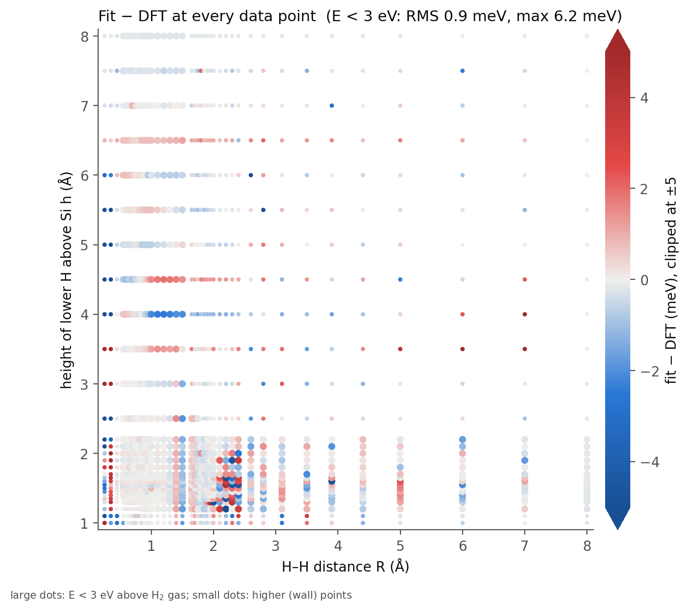
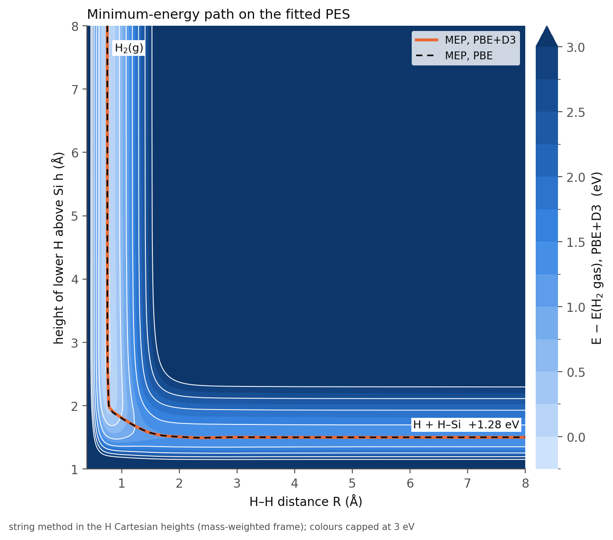
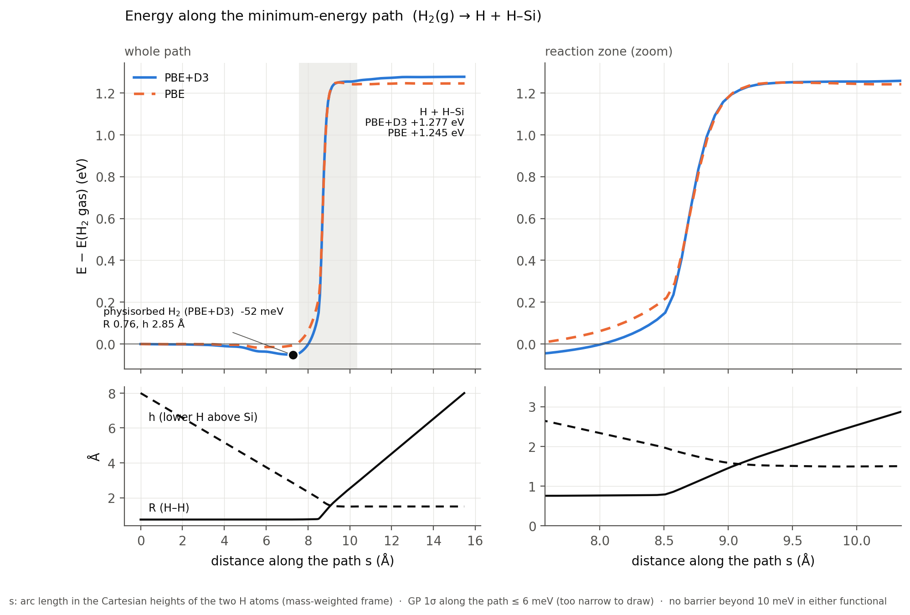

# 2D potential energy surface for H<sub>2</sub> on Si(111) (VASP PBE-D3)

A two-dimensional potential energy surface (PES) for an H<sub>2</sub> molecule standing upright
above one surface Si atom (Si\*) of a frozen Si(111) slab: 1159 VASP single-point energies
(PBE + D3) on a 29 × 40 grid, plus a smooth fitted surface with analytic gradients for dynamics
and reaction-path work.

- **Main data: [`fit/pes_r1r2_E0.csv`](fit/pes_r1r2_E0.csv)**: r1, r2 (Å) and E0 (eV).
- **Fitted PES: [`fit/pes_model.joblib`](fit/pes_model.joblib)** (load with
  [`fit/pes_model.py`](fit/pes_model.py)): energy, gradient and uncertainty at any (r1, r2).
- Short report (5 pages, same content with more context):
  [`report/PES_report.pdf`](report/PES_report.pdf) (`.docx` alongside). Detailed working notes,
  all settings, decisions and pitfalls: [`CLAUDE.md`](CLAUDE.md).

**Contents:** [System and coordinates](#1-system-and-coordinates) ·
[How the data were computed](#2-how-the-data-were-computed) · [The data](#3-the-data) ·
[The fit](#4-the-fitted-surface) · [Results](#5-main-results) ·
[Using it](#6-using-the-data-and-the-fitted-pes) · [Repository layout](#7-repository-layout) ·
[Rebuilding](#8-rebuilding-and-extending) · [Limits](#9-limits-of-validity) ·
[Not included](#10-not-in-this-repository)

---

## 1. System and coordinates



- **Surface:** Si(111) slab, 24 Si atoms, periodic cell 7.680 × 6.651 × 40.406 Å (about 32 Å of
  vacuum). The top surface is reconstructed (Si 1, 2, 13, 14 are three-coordinated); the bottom
  layer is not H-passivated. All Si atoms are frozen.
- **Molecule:** H<sub>2</sub> is collinear with the surface normal, directly above Si 13 (Si\*):
  a straight Si\*–H1–H2 line.
- **Coordinates:** r1 = H1–H2 distance; r2 = height of the lower atom H1 above Si\*. H2 sits
  at r1 + r2 above Si\* (Si\* at z = 7.944237 Å in the cell). In the scripts the same coordinates
  are called **R (= r1)** and **h (= r2)**. Distances in Å, energies in eV everywhere (only the
  figures in `figs_r1r2/` use bohr).
- **Limits of the surface:**
  - r1 large, r2 large: two free H atoms;
  - r1 = 0.75 Å, r2 large: gas-phase H<sub>2</sub>;
  - r1 large, r2 ≈ 1.5 Å: one H bonded to Si\* (Si–H) and one free H.

  The PES therefore connects H<sub>2</sub> approaching the surface with dissociative adsorption
  and, read backwards, with Eley–Rideal abstraction H + H–Si → H<sub>2</sub>.

<br clear="right">

## 2. How the data were computed

Every point is a separate single-point (no relaxation) self-consistent DFT calculation with
VASP 6.3.2.

| Setting | Value | Why / note |
|---|---|---|
| Functional | PBE + D3(BJ) (`IVDW = 12`) | D3 is an additive, non-self-consistent term: PBE alone = E0 − Edisp (`Edisp` in OUTCAR) |
| Basis, precision | PAW (PBE Si 05Jan2001, H 15Jun2001), `ENCUT = 400` eV, `PREC = Normal` | |
| k-points, smearing | 16 irreducible k-points; Gaussian, `SIGMA = 0.2` eV | energy used: E0 (σ → 0) |
| Spin | `ISPIN = 2`, `MAGMOM = 24*0 1 -1`, `AMIX_MAG = 0.8`, `BMIX_MAG = 0.0001` | slab non-magnetic, the two H spins opposite (broken-symmetry singlet): H<sub>2</sub> dissociates correctly into two atoms. Parallel starting spins put H<sub>2</sub> in the repulsive triplet. |
| Geometry | `IBRION = -1`, `NSW = 0` | frozen slab, H positions fixed by (r1, r2) |
| Parallelisation | `KPAR = 16`, `NCORE = 2`, 32 MPI ranks | `LORBIT = 11` for the per-atom magnetic moments |

### Grid and scan procedure

- **29 heights:** r2 = 1.00–1.30 (step 0.1), 1.30–1.70 (0.05), 1.70–2.20 (0.1), 2.50–8.00 Å (0.5).
- **40 H–H distances per height:** r1 = 8.00, 7.00, 6.00, 5.00, 4.40, 3.90, 3.50, 3.10, 2.80,
  2.60, 2.40, 2.30, …, 0.35, 0.25 Å (dense between 0.6 and 2.4 Å).
- Each height is one scan in `SCF_data/<r2>/` (driven by `scan.sh`). It starts at r1 = 8 Å and
  walks **inward**, each point restarting from the previous point's wavefunction and charge
  density. The direction matters: starting from closed-shell H<sub>2</sub> and walking outward
  keeps the restricted solution past the point where the H<sub>2</sub> spin symmetry breaks
  and gives energies that are far too high.

<p align="center"></p>
<p align="center"><b>The DFT data</b> (PBE+D3) relative to gas-phase H<sub>2</sub>. White lines:
the 29 computed heights. The light valley on the left is intact H<sub>2</sub>; the one along the
bottom (r2 ≈ 1.5 Å) is H bonded to Si* with the other H free. Colours capped at 8 eV; the
r1 = 0.25 Å wall reaches about 30 eV.</p>

### Slab spin state and reruns

The unpassivated slab has two nearly degenerate electronic states: a non-magnetic one and one
with spin-polarized dangling bonds (about 0.2 eV lower). Almost all scan points sit in the
non-magnetic state, but some SCF runs drifted partly toward polarization. This gave
10–30 meV offsets for whole rows and about 20 single points 6–42 meV too high.

- **Decision:** the non-magnetic slab everywhere, as one consistent reference.
- Suspicious points were recomputed in three rerun rounds with the total spin fixed
  (`NUPDOWN`). A rerun was accepted only if the dangling-bond Si atoms (Si 1, 2, 14, 9, 10, 23,
  24) stayed non-magnetic: Σ|m| < 0.15 μ<sub>B</sub>.
- 175 rerun points replaced scan values (170 from round 1, 4 from round 2, 1 from round 3). They
  sit in their height directories; `R_<r1>/source.txt` names the round, and the original scan
  outputs are kept in `R_<r1>/scan_old/`.
- One point (r2 = 3.00, r1 = 2.60) has no trustworthy non-magnetic energy and is left out:
  **1159 of 1160 points** are used.
- QC (`fit/qc.py`, leave-one-out along each row): no energy outliers, rms per row ≤ 3.1 meV.
- Rows r2 = 3.0–4.0 Å keep scan values with 10–20 meV slab-state offsets (their reruns
  polarized), so features smaller than about 20 meV there are within the data uncertainty.

## 3. The data

### `fit/pes_r1r2_E0.csv` (main file)

| Column | Meaning | Unit |
|---|---|---|
| `r1` | H1–H2 distance (= R) | Å |
| `r2` | height of H1 above Si\* (= h) | Å |
| `E0` | total energy of the slab + 2 H cell, PBE+D3, absolute (VASP E0) | eV |

The energies are absolute; subtract a reference before use:

| Reference | Point | E0 (eV) |
|---|---|---|
| Two free H atoms (zero of the fitted model) | r1 = 8, r2 = 8 | −129.37379 |
| Gas-phase H<sub>2</sub> (zero of the figures and results) | r1 = 0.75, r2 = 8 | −133.90415 |

The difference, 4.530 eV, is approximately the H<sub>2</sub> well depth D<sub>e</sub>.

### `fit/pes_data.csv` (full table, same 1159 points)

| Column | Meaning |
|---|---|
| `h`, `R` | r2 and r1 (Å) |
| `z_low`, `z_up` | heights of H1 and H2 above Si\* (Å) |
| `F`, `E0` | VASP free energy and E0 (eV) |
| `Edisp` | D3 dispersion part of E0 (eV) |
| `E_pbe` | PBE without dispersion = E0 − Edisp (eV) |
| `mag`, `mH1`, `mH2` | total magnetic moment and the moments on H1 and H2 (μ<sub>B</sub>) |
| `steps` | SCF steps |
| `status`, `src` | convergence flag; source of the value (`scan`, `reruns`, `reruns2`, `reruns3`) |

Use `E_pbe` to work with PBE alone, without dispersion.

### Per-point VASP files

`SCF_data/<r2>/R_<r1>/` holds `INCAR`, `KPOINTS`, `POSCAR` and `OSZICAR` of every point, and
`SCF_data/<r2>/<r2>.dat` is a per-height table (r1, z of H2, F, E0, moments, SCF steps, status).

## 4. The fitted surface

The energy range (−4.5 to +30 eV) and the flat asymptotes are hard for a single
machine-learning model, so the fit learns only what is left after a physical baseline
(Δ-learning). With energies relative to the free atoms:

```
V(r1, r2) = V_HH(r1) + V_H(r2) + V_H(r1 + r2) + T(r1)·T(r2)·I_GP(r1, r2)  [+ D_GP(r1, r2)]
```

- **V_HH(r1):** the gas-phase H<sub>2</sub> curve, i.e. the r2 = 8 row of the data.
- **V_H(z):** one H atom against the surface (Si–H curve), the r1 = 8 column. Both 1D curves are
  cubic splines, with an exponential repulsive wall below the grid and constant above it.
- **I_GP:** Gaussian-process regression (scikit-learn; Matérn 5/2 + white-noise kernel; inputs
  exp(−r1), exp(−r2)) on the remaining three-body part. It is exactly zero on both 1D cuts and
  is switched off smoothly by the taper T between 5.5 and 8 Å, so both asymptotic channels equal
  the 1D curves exactly and the surface stays physical outside the grid.
- **D_GP:** a second, small GP for the D3 term, so dispersion can be switched off (PBE only).
- **Gradients** are analytic (spline derivatives plus the closed-form kernel derivative),
  checked against finite differences to 0.01 meV/Å. The GP also returns an uncertainty σ
  (`fit/sigma_map.png`).

**Quality** (energies below 3 eV above gas-phase H<sub>2</sub>; `fit/fit_report.txt`):

| Test | RMSE | Max |
|---|---|---|
| Training error (all 1159 points) | 0.9 meV | 6.2 meV |
| Leave a whole height out (r2 = 1.35, 1.45, 1.55, 1.65, 2.10) | 1.0–3.4 meV | 13.4 meV |
| Leave out r2 = 3.50 (row with a slab-state offset) | 14 meV | 23 meV |
| Leave out every other r1 | 3.4 meV | 14 meV |
| Gas-phase H<sub>2</sub> from the fit | r<sub>e</sub> 0.7509 Å, D<sub>e</sub> 4.531 eV, ω<sub>e</sub> 4276 cm<sup>−1</sup> | |

<table>
<tr>
<td align="center"><br><b>Fitted surface</b> (PBE+D3) with the DFT points</td>
<td align="center"><br><b>Fit − DFT</b> at every point (meV)</td>
</tr>
</table>

## 5. Main results

PBE+D3, relative to gas-phase H<sub>2</sub> (`fit/analyze_report.txt`):

| Quantity | Value |
|---|---|
| H + H–Si (r1 → ∞, r2 = 1.50 Å) | +1.277 eV (PBE: +1.245 eV) |
| Si–H bond, frozen slab | 1.501 Å; binding 3.254 eV vs a free H atom; 2022 cm<sup>−1</sup> |
| Si–H binding, slab relaxed (bottom bilayer fixed) | 3.159 eV (−0.095 eV) |
| Physisorbed H<sub>2</sub> | −52 meV at r2 = 2.85 Å (mostly D3) |
| Barrier on the minimum-energy path | none beyond 10 meV |

The minimum-energy path (string method on the fitted surface) has no barrier. Dissociating
H<sub>2</sub> onto Si\* costs only the endothermicity of +1.28 eV, and Eley–Rideal abstraction
H + H–Si → H<sub>2</sub> is barrierless and exothermic by the same amount in this collinear
geometry. The relaxed-slab number comes from two separate relaxations
(`relax_SiH_fixbot/`, `relax_Si111_fixbot/`); the PES itself is frozen-slab.

<table>
<tr>
<td align="center"><br><b>Minimum-energy path</b> on the fitted PES</td>
<td align="center"><br><b>Energy and coordinates</b> along the path</td>
</tr>
</table>

## 6. Using the data and the fitted PES

**Raw data** (pandas):

```python
import pandas as pd
d = pd.read_csv("fit/pes_r1r2_E0.csv")
E_gas = d.query("r1 == 0.75 and r2 == 8.0").E0.item()   # -133.90415 eV
d["V"] = d.E0 - E_gas                                     # eV relative to gas-phase H2
```

**Fitted PES** (run in `fit/`, or put `fit/` on `sys.path`: the pickle needs `pes_model.py`):

```python
import joblib, pes_model
pes = joblib.load("pes_model.joblib")
E  = pes.energy(r1, r2, d3=True, ref="gas")   # eV vs gas-phase H2; ref="atoms": vs free atoms
g  = pes.gradient(r1, r2)                     # (dV/dr1, dV/dr2), eV/A, shape (..., 2)
s  = pes.sigma(r1, r2)                        # GP uncertainty (eV)
E2 = pes.energy_com(r1, Z)                    # from the H2 centre-of-mass height Z
E3 = pes.energy_z(z1, z2)                     # from the heights of H1 and H2 above Si*
```

All functions take scalars or NumPy arrays (broadcast) and `d3=False` gives PBE only. For
example, `pes.energy(8.0, 1.5, ref="gas")` gives +1.277 eV (H + H–Si).

**Requirements:** Python 3.10, numpy 2.2, scipy 1.15, scikit-learn 1.7, pandas 2.2,
matplotlib 3.10, joblib 1.5 (the versions used). The pickled model needs a compatible
scikit-learn; otherwise refit with `python3 fit_pes.py` (about 20 min) from `fit/pes_data.csv`.

## 7. Repository layout

| Path | Content |
|---|---|
| `SCF_data/<r2>/` (29 heights, e.g. `SCF_data/1.50/`) | one scan: `INCAR`, `KPOINTS`, `scan.sh`, table `<r2>.dat`, one `R_<r1>/` per point |
| `SCF_data/<r2>/R_<r1>/` | `INCAR`, `KPOINTS`, `POSCAR`, `OSZICAR` of each point; `source.txt` + `scan_old/` if the point is a rerun |
| `fit/pes_r1r2_E0.csv`, `fit/pes_data.csv` | the data (section 3) |
| `fit/pes_model.joblib`, `fit/pes_model.py` | the fitted PES, class `PES` |
| `fit/collect_data.py` | gathers converged points from `SCF_data/` → both CSV files (needs the OUTCARs) |
| `fit/qc.py` | leave-one-out outlier and spin-state checks → `qc_report.txt` |
| `fit/fit_pes.py` | fit + cross-validation → `pes_model.joblib`, `fit_report.txt` |
| `fit/plot_fit.py` | fit figures: `fit_pes_2d.png`, `fit_cuts.png`, `fit_pes_3d.png` |
| `fit/analyze.py` | minimum-energy path and energetics → `analyze_report.txt`, `mep_*.png`, `sigma_map.png`, `residuals_map.png` |
| `plot_pes2d3d.py` | data maps `pes_2d.png`, `pes_3d.png` |
| `figs_r1r2/` | paper-style figures in bohr (`make_figs.sh`: gnuplot + VMD) |
| `relax_SiH_fixbot/`, `relax_Si111_fixbot/` | slab relaxations with the bottom bilayer fixed; `summary.py`, `binding.py` (Si–H binding), `structure_change.py` |
| `report/` | the report (`.pdf`, `.docx`) and its generator `make_report.py` |
| `submit.example` | sample SLURM script for a height scan (`scan.sh` needs `VASP_CMD`) |
| `CLAUDE.md` | detailed project notes: settings, decisions, pitfalls |

## 8. Rebuilding and extending

- **Refit and redraw** from the data in the repository (in `fit/`):
  `python3 fit_pes.py && python3 plot_fit.py && python3 analyze.py`, then
  `python3 plot_pes2d3d.py` and `bash figs_r1r2/make_figs.sh` from the top.
- **Recompute or add points:** copy `submit.example` to `SCF_data/<r2>/submit`, fill in your
  cluster details and add the POTCAR (section 10). `bash submit` runs the scan; it skips
  converged points and restarts from the last one. `bash scan.sh --check` returns 0 when all
  40 points of a height are converged. Then run `collect_data.py`, `qc.py` and the refit.
- **New height:** create `SCF_data/<r2>/` with `INCAR`, `KPOINTS`, `POTCAR` and `scan.sh` copied
  from an existing height; the height is taken from the directory name.

## 9. Limits of validity

- Frozen slab, upright H<sub>2</sub> on a single site (2D), PBE+D3 with a non-magnetic slab.
- The data cover r1 = 0.25–8 Å and r2 = 1.0–8 Å. Outside the grid the model falls back to the 1D
  curves: well behaved, but not checked against DFT.
- Least certain regions: the gap between r2 = 2.2 and 2.5 Å, the sparser rows above it, and rows
  r2 = 3.0–4.0 Å (slab-state offsets). See `fit/sigma_map.png`.

## 10. Not in this repository

- **POTCAR files** (VASP license). To rerun a point, add your own PAW_PBE `Si 05Jan2001` +
  `H 15Jun2001` POTCAR (in that order).
- Large VASP outputs (OUTCAR, CONTCAR, XDATCAR, vasp.out, …) of the single points. Their
  energies, D3 terms and moments are in `fit/pes_data.csv`, so the fit and all figures can be
  rebuilt from the repository, but `fit/collect_data.py` (which reads the OUTCARs) can only be
  rerun after recomputing the points.
- Cluster job scripts; use `submit.example` as a template.
